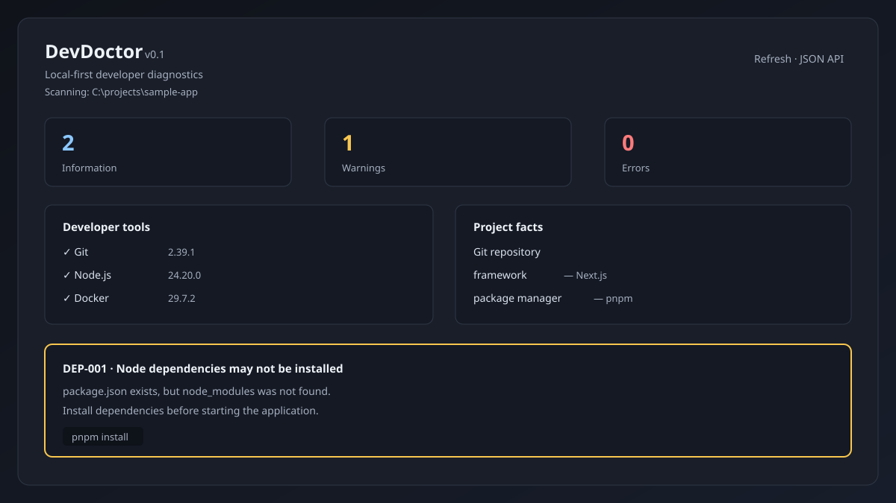
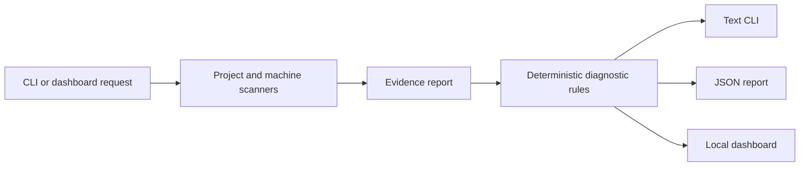

# DevDoctor

[](https://github.com/garvmotwani/DevDoctor/actions/workflows/ci.yml)

A local-first developer diagnostics tool for finding setup problems before they
become debugging sessions. DevDoctor combines a fast Go CLI, machine-readable
JSON, and a private browser dashboard — all without uploading project data.



## Why DevDoctor?

New projects often fail for ordinary, hard-to-spot reasons: dependencies were
not installed, a local environment variable is missing, a lockfile conflicts
with another package manager, or a development port is already occupied.
DevDoctor gathers local evidence and explains the likely cause with a safe
suggested next step. It never executes a fix automatically.

### Highlights

- **Local-first by design.** No project data leaves the machine; the dashboard
  binds only to `127.0.0.1`.
- **Security-aware configuration checks.** `.env` values are discarded during
  parsing, so they cannot appear in terminal output, JSON, or the dashboard.
- **Practical stack insight.** Detects Node.js, Python, Docker, Git, common
  frameworks, package managers, and occupied development ports.
- **Automation-ready.** Text, JSON, and documented exit codes support both
  human workflows and CI scripts.

## Quick start

Prerequisite: [Go 1.21+](https://go.dev/dl/).

```bash
git clone https://github.com/garvmotwani/DevDoctor.git
cd DevDoctor
go run .
```

To open the local dashboard:

```bash
go run . serve
```

DevDoctor prints a loopback URL such as `http://127.0.0.1:8081`. Open it in a
browser, then press `Ctrl+C` in the terminal when you are done.

## Architecture



Scanners collect facts; rules interpret those facts. Rendering is separate,
which keeps the results consistent across every interface and makes rules easy
to test.

A local-first developer diagnostics CLI. DevDoctor scans your machine and a
project directory, detects common problems (missing tools, missing
dependencies, broken configuration), and explains likely causes with safe,
suggested fixes.

Local-first means the analysis runs entirely on your computer. Nothing is
uploaded. Secrets are never printed.

## Status

| Phase | Feature                                  | State    |
| ----- | ---------------------------------------- | -------- |
| 0     | Project scaffold, runnable CLI           | done     |
| 1     | System info (OS, architecture)           | done     |
| 2     | Developer tool detection                 | done     |
| 3     | Project detection                        | done (tests included) |
| 4     | Diagnostic rule engine                   | done (tests included) |
| 5     | Environment variable diagnostics         | done (tests included) |
| 6     | Subcommands, JSON output, exit codes     | done (tests included) |
| 7     | Port and process diagnostics             | done (tests included) |
| —     | Project intelligence (package.json facts)| done (tests included) |

## Commands

```bash
# scan the current directory (default, human-readable text)
go run .

# same scan as one JSON document
go run . --json

# scan a specific project directory
go run . scan ./some-project

# scan a specific directory and emit JSON
go run . scan --json ./some-project

# open the local browser dashboard (the printed URL uses a free port from 8080–8089)
go run . serve ./some-project
```

`--json` is accepted before or after `scan`. Unknown subcommands, unknown
flags and extra positional arguments are rejected with a short usage message
instead of being guessed at.

## Local dashboard

`devdoctor serve [directory]` provides a browser UI with the same report as
the CLI, including a refreshable dashboard and a `GET /api/report` JSON
endpoint. It binds only to a `127.0.0.1` loopback address, so it is accessible from the
local machine only and sends no project data over the network. If port 8080
is occupied, DevDoctor tries the next available port through 8089 and prints
the exact URL to open.

## Project intelligence

For Node.js projects, DevDoctor safely reads the small diagnostic subset of
`package.json`: the declared Node.js engine, declared package manager, and
well-known framework dependencies (Next.js, Vite, React, Vue, Angular and
Svelte). It also reports malformed `package.json` files and conflicting
lockfiles. Dependency version strings and unrelated manifest content are not
included in the report.

## Build

```bash
go build -o devdoctor .
```

## Test

```bash
go test ./...
```

Project and environment detection are tested against in-memory filesystems
(`fstest.MapFS`), so tests never touch the real disk. The CLI layer is tested
with temporary directories and a stubbed tool check, so it never runs version
commands either.

## Continuous integration

GitHub Actions runs the following on every push and pull request:

```bash
go test ./...
go vet ./...
go build ./...
```

This keeps the command-line tool and its local dashboard buildable as the rule
set grows.

## Exit codes

DevDoctor is usable from scripts and CI because the exit code reflects what it
found, not just whether it ran:

| Code | Meaning                                                                 |
| ---- | ----------------------------------------------------------------------- |
| 0    | Scan completed with no warnings and no errors                           |
| 1    | Scan completed, but at least one warning or error was reported          |
| 2    | Invalid usage, invalid path, or the scan/runtime itself failed          |

Informational diagnostics (for example `GIT-001`, a note that the directory is
not a Git repository) are shown but do not count as problems, so a run that
reports only information still exits `0`.

```bash
go run . scan ./some-project
echo $?   # 0 when clean, 1 when something needs attention
```

Errors that prevent a scan from happening at all — bad flags, a directory that
does not exist, a path that is a file — are written to stderr and exit `2`.

## JSON output

`--json` prints a single JSON object on stdout and nothing else. It contains:

- `version` — the DevDoctor version
- `root` — the absolute path that was scanned
- `system` — `os` and `architecture`
- `tools` — `name`, `status` (`ok`, `not_found`, `error`) and `version` when known
- `ports` — occupied development ports as `port`, `protocol`, and `process`/`pid` when readable
- `facts` — project facts as `label` and `detail`
- `diagnostics` — `id`, `severity`, `title`, `description`, `evidence`, `suggestedFix`
- `summary` — counts for `info`, `warnings` and `errors`

The document is deterministic: the same inputs produce byte-identical output,
fields always appear in the same order, and empty collections are `[]` rather
than `null`.

**JSON safety guarantee:** `.env` values are never stored, so they cannot be
emitted. The scanner parses environment files into variable *names*, empty
declarations and malformed line *numbers* only; the same rule applies to text
and JSON output alike. Tool paths and underlying tool errors are also omitted —
they describe the local machine, not the project.

```bash
go run . --json | grep -c 'SECRET'   # 0 unless the word is in a variable name
```

## Ports and processes

DevDoctor checks a small set of development ports — `3000`, `5173`, `8000`,
`8080`, `5432`, `6379` — and reports who owns each occupied one:

```text
[1] ℹ Port 8000 is in use
    PORT-001 (info)

    Evidence: TCP listening socket on port 8000; process: node.exe; PID: 23976
```

**DevDoctor never stops, signals or suspends a process.** It only reads and
reports. Suggesting "kill this PID" would be dangerous advice: the process may
be your own dev server, a database you want running, or something the system
needs. A busy port is therefore reported as *information*, not a warning, and
it does not change the exit code on its own. It becomes a problem only when
something fails to bind, which is a question DevDoctor answers in a later
phase, not one it guesses at now.

How the information is obtained differs by platform — the operating systems
really do expose this differently:

| OS      | Mechanism                                                    |
| ------- | ------------------------------------------------------------ |
| Windows | `netstat -ano -p tcp` for listening sockets and PIDs, `tasklist /FO CSV /NH` for process names |
| Linux   | `/proc/net/tcp` and `/proc/net/tcp6` for sockets, `/proc/<pid>/fd` to match a socket inode to its owner, `/proc/<pid>/comm` for the name |
| other   | not implemented; the scan says so (`PROC-001`) instead of claiming no ports are in use |

Windows has no `/proc`, and the IP Helper API that holds the same data needs
cgo. Linux has `/proc` but `ss`, `netstat` and `lsof` are optional packages, so
DevDoctor reads the kernel files directly and runs no external program there.

Two boundaries are respected on purpose:

- **Permissions.** A standard user cannot see other users' processes. Those
  ports are still reported, with the PID if it is known and an explicit note
  that the name could not be read. DevDoctor reports the limit; it does not ask
  for root or an administrator prompt to get around it.
- **Privacy.** Only the process *name* is read. Command lines are not: they
  routinely contain tokens, connection strings and passwords, and a
  diagnostics report must not copy those into a terminal or a JSON document.

```bash
go run . scan --json . | grep -A2 '"ports"'
```

## Principles

- Go standard library first; no dependencies without a compelling reason.
- Deterministic diagnostics before any AI features.
- Never print secret values (e.g. from `.env`).
- Every suggested fix is displayed before it could ever be executed.
- No process is ever stopped. Port and process diagnostics are read-only, and
  no rule in this phase produces a fix command at all.
- Package-manager fixes are suggested only when one lockfile identifies a
  single manager; DevDoctor never guesses between npm, pnpm, Yarn, or Bun.
- One source of truth: the CLI renders what the rules produced and never
  re-derives a problem of its own.
